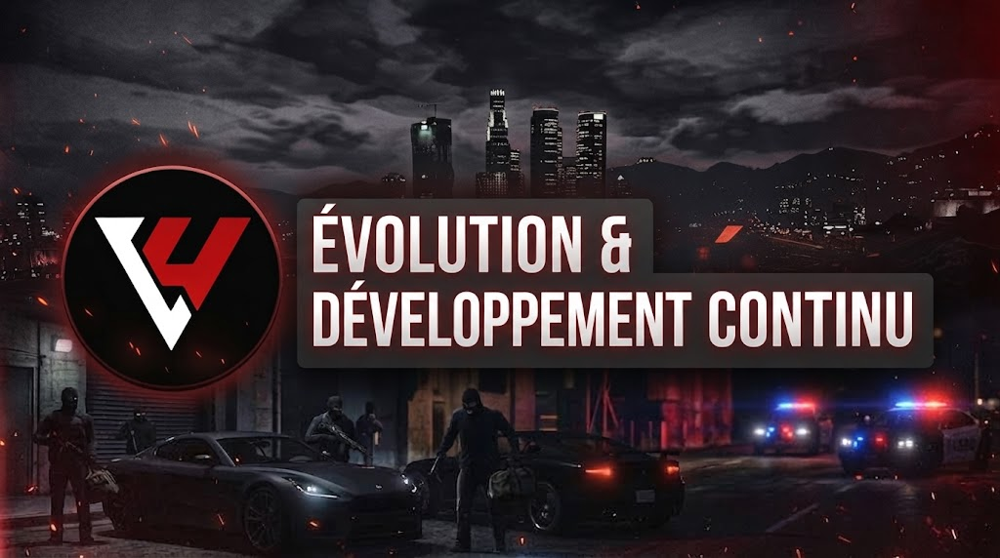

# Évolution & Développement Continu 🚀

<figure><figcaption></figcaption></figure>

Le projet Liberty UnderWorld est pensé comme un écosystème vivant en constante amélioration. Que ce soit sur le serveur FiveM, sur notre infrastructure Discord ou sur cette documentation officielle, nos équipes procèdent régulièrement à des ajustements, des correctifs et des ajouts de fonctionnalités.

> 🛠️ État du projet : Le serveur, le Discord et le wiki sont actuellement en cours de développement continu. Des modifications structurelles ou de règles peuvent intervenir afin d'équilibrer l'expérience globale de jeu.

### 1. Un Projet Participatif

La communauté est au cœur de l'évolution du serveur. Nous considérons que les meilleures mécaniques et les meilleurs ajustements de règles naissent des retours directs de ceux qui pratiquent le terrain au quotidien :

* Écoute active : Toutes les idées argumentées sont lues, étudiées et débattues en interne par l'équipe de développement et d'administration.
* Transparence : Chaque mise à jour majeure fait l'objet d'un registre des modifications (_patchnote_) consultable directement dans les annonces de notre Discord.
* Documentation évolutive : Ce wiki est mis à jour en temps réel au fil des ajouts de scripts, de véhicules ou de modifications législatives.

### 2. Soumettre une Suggestion

Vous avez une idée pour enrichir le Roleplay, un concept d'entreprise innovant, une proposition d'équilibrage économique ou une amélioration ergonomique pour le wiki ?

Rendez-vous dans le salon officiel dédié sur notre Discord : `#suggestions`.

#### Recommandations pour vos propositions

Pour maximiser l'impact de votre suggestion et accélérer son traitement :

* Développez le concept : Expliquez en quoi la fonctionnalité ou la règle apporte une plus-value concrète pour l'ensemble des joueurs (et pas seulement pour votre propre personnage).
* Pensez faisabilité : Précisez si l'idée repose sur un ajout de mécanique, une refonte de règlement ou un ajustement d'équilibrage.
* Vote communautaire : Utilisez le système de réactions pour soutenir les propositions d'autres membres qui vous semblent pertinentes.

### 3. Signalement d'Anomalies & Erreurs

En phase de développement actif, des instabilités techniques ou des coquilles rédactionnelles peuvent subsister :

* Bugs en jeu : Si vous constatez un problème technique sur un véhicule, une zone de récolte ou une interface, signalez-le sans tarder via un ticket dans `#ouvrir-un-ticket > Bug Technique`.
* Erreurs sur le wiki : Si un passage du règlement manque de précision ou si une touche renseignée est inexacte, faites remonter l'information à l'équipe de modération pour correction immédiate.

Merci pour votre investissement et votre soutien dans la construction de Liberty UnderWorld !
