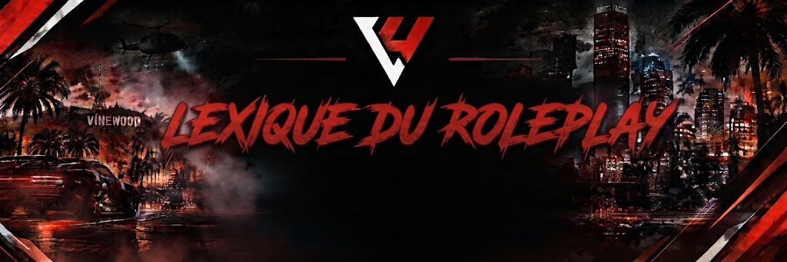

# Lexique du Roleplay 💬

<figure><figcaption></figcaption></figure>

Ce lexique rassemble l'ensemble des termes, concepts et abréviations indispensables pour interagir sur le serveur.

> ⚠️ Rappel formel : Tous ces termes relèvent du jargon technique (HRP). Il est strictement interdit de les prononcer tels quels à l'oral en jeu sous peine de sanction pour sortie de personnage.

### 1. Fondations & Frontières RP / HRP

* RP (Roleplay) : L'incarnation fictive de votre personnage. Tout ce qui relève de ses émotions, ses choix, son argent et ses interactions dans la ville.
* HRP (Hors Roleplay) : L'univers réel du joueur derrière l'ordinateur (problèmes de connexion, micro, Discord, équipe d'administration).
* Casser son personnage : Parler de manière non RP en jeu, faire allusion à la vraie vie ou crier à l'infraction en pleine scène au lieu de continuer à jouer.
* In-Game (IG) : Désigne les actions se déroulant directement à l'intérieur du serveur de jeu.
* Out-Of-Game (OOG) : Désigne tout échange extérieur (salons écrits Discord, messages privés, streams).

### 2. Règles d'Incarnation & Cohérence

* Fear RP : Notion fondamentale exigeant de valoriser la vie de son personnage par-dessus tout. Menacé par une arme à feu ou encerclé par plusieurs individus hostiles, le joueur est tenu d'obtempérer et de manifester sa peur.
* Pain RP : Prise en compte réaliste des impacts physiques (accidents de voiture, chutes de hauteur, tirs d'armes). Cela implique des gémissements, une mobilité réduite et l'attente des services de secours.
* Powergaming :
  * Réaliser une action physiquement irréalisable dans le monde réel (ex. : continuer à courir après une chute de trois étages).
  * Forcer une action sur autrui sans lui laisser de possibilité technique ou narrative de s'y opposer (ex. : annoncer arbitrairement avoir assommé quelqu'un sans concertation ni duel).
* Metagaming : Utilisation délibérée d'informations acquises hors du champ de vision ou d'audition du personnage (ex. : localiser un convoi grâce à un live Twitch ou un appel vocal Discord). Assimilé à de la triche pure.
* Win RP : Posture consistant à vouloir systématiquement remporter les confrontations au mépris du plaisir narratif partagé. Savoir perdre ou être arrêté enrichit le jeu pour tout le monde.
* Mass RP : Prise en compte de la population urbaine invisible. La ville n'est pas un désert : les lieux administratifs, les axes majeurs et les hôpitaux sont réputés entourés de caméras, de passants et de témoins.

### 3. Combats & Agression

* FRP (Free RP / Freekill / Freehit) : Donner des coups, blesser ou abattre un civil sans justification scénaristique solide ni contact vocal explicite préalable.
* Sommations : Avertissements clairs et audibles donnés à la voix imposant une action sous peine de représailles armées. Trois sommations distinctes sont requises avant toute ouverture de feu, hors assaut planifié validé.
* Car-Jacking : Éjection ou vol violent d'un véhicule occupé par la force sans aucune phase de négociation ou d'intimidation préalable.
* Drive-by : Tir opéré depuis l'habitacle d'un véhicule en marche. Soumis aux limitations du Pôle Illégal.
* Revenge Kill : Fait de retourner agresser ou traquer les individus responsables de sa propre mise au sol immédiatement après avoir été soigné par les services médicaux.
* Safezone (Zone Sûre) : Espaces protégés où toute action malveillante, agression, vol ou enlèvement est rigoureusement prohibé (Hôpitaux, Commissariats, Mairie, Pôle Emploi).

### 4. États de Santé & Mémoire

* Coma RP : État d'inconscience complète suite à des blessures graves. Le personnage gît au sol et ne peut ni utiliser sa radio, ni émettre de paroles cohérentes, ni ouvrir son inventaire.
* NLR (New Life Rule) : Règle s'appliquant lorsqu'un joueur se réveille à l'hôpital sans avoir été soigné sur place par un médecin. Il subit une amnésie partielle et oublie les trente minutes précédant son coma ainsi que l'identité de ses assaillants.
* Mort RP (Wipe) : Disparition irréversible d'un personnage validée par les responsables de modération. Entraîne la suppression des biens et l'obligation de créer un personnage vierge de tout lien passé.
