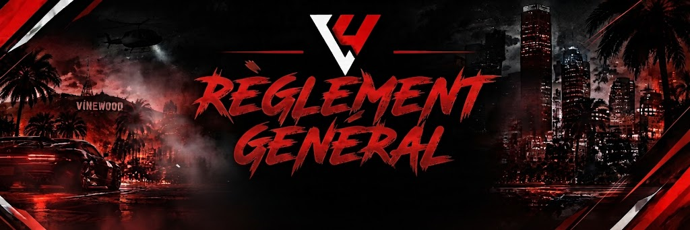

# Règlement Général 📖

## Règlement Général — Liberty UnderWorld

<figure><figcaption></figcaption></figure>

Bienvenue sur le règlement officiel de Liberty UnderWorld. Toute connexion au serveur implique l'acceptation sans réserve de l'ensemble des règles énoncées ci-dessous. Nul n'est censé ignorer le règlement.

> ⚖️ Philosophie du serveur : Le fair-play, la cohérence narrative et le respect mutuel passent avant la victoire. Jouez pour créer une histoire intéressante pour tout le monde.

### 1. Comportement Communautaire & Respect (HRP)

* Tolérance Zéro : Tout propos raciste, homophobe, sexiste, haineux, diffamatoire ou discriminatoire entraîne un bannissement permanent immédiat.
* Respect du Staff : Les décisions de l'équipe de modération/administration doivent être respectées. En cas de désaccord, contestez calmement via un ticket Discord avec des preuves vidéo.
* Toxicité & Provocations : Les comportements toxiques en jeu, sur Discord ou sur les réseaux sociaux (streams, TikTok) nuisant à l'ambiance du serveur sont sanctionnés.
* Double Compte : L'usage de plusieurs comptes FiveM ou Discord pour esquiver des sanctions ou dédoubler des avoirs est formellement interdit.

### 2. Principes Fondamentaux du Roleplay

* Fear RP (Peur de mourir) : Votre personnage n'a qu'une seule vie. Face à une arme à feu pointée sur vous, une supériorité numérique écrasante ou un danger létal direct, vous devez obtempérer et montrer de la peur.
* Pain RP (Douleur physique) : Après un accident de voiture, une chute importante ou une blessure par balle, vous devez jouer la douleur de manière réaliste et attendre les secours médicaux.
* Powergaming : Réaliser des actions impossibles dans la vraie vie (ex. : sauter d'un toit et continuer à sprinter, sauter des montagnes en sportive, rouler sur 4 pneus crevés) est interdit. Forcer une action sur un joueur sans lui donner l'opportunité de réagir l'est également.
* Metagaming : Utiliser des informations obtenues hors du jeu (Discord, streams Twitch, tchats externes) dans l'intérêt de votre personnage RP est considéré comme de la triche.
* No Fear Police : Les forces de l'ordre représentent l'autorité armée et légale. Les provoquer sans raison valable ou refuser d'obtempérer sous la menace est sanctionné.
* Win RP : Privilégier la "victoire" à tout prix plutôt que la qualité de la scène est strictement proscrit. Savoir perdre fait partie intégrante du RP.

### 3. Combats & Agression

* FRP / Freekill / Freehit : Blesser, attaquer ou abattre un joueur sans raison scénaristique valable et sans interaction vocale préalable est lourdement sanctionné.
* Sommations : Toute ouverture de feu doit être précédée de sommations verbales audibles et explicites, sauf cas d'extrême urgence RP déjà validé par le contexte.
* Revenge Kill : Il est strictement interdit de revenir sur le lieu de votre mort ou de chercher à vous venger des personnes impliquées après avoir été réanimé par les secours.
* Zone Sûre (Safezone) : Commissariats, hôpitaux, mairie et pôle emploi sont des zones de paix absolue. Tout acte violent, braquage ou enlèvement y est interdit.

### 4. Cohérence des Véhicules & Conduite

* Conduite HRP : Conduire en ville à 250 km/h en permanence, utiliser du mobilier urbain comme tremplin ou conduire des véhicules inadaptés sur le relief (ex. : berlines de luxe sur les falaises) est interdit.
* Pit / Car-Jacking : Taper délibérément les véhicules à pleine vitesse pour les envoyer dans le décor (Pit excessif) est assimilé à du Powergaming.

### 5. Gestion des Conflits & Tickets

* Pas de coupure de scène : Il est strictement interdit d'interrompre une scène RP en criant au "HRP" ou en parlant de modération à l'oral en jeu. Jouez la scène jusqu'au bout.
* Recours : Si une infraction a été commise, terminez la scène puis ouvrez un ticket d'aide sur le Discord avec un enregistrement vidéo (Medal, OBS, Shadowplay) montrant l'action dans son ensemble.
