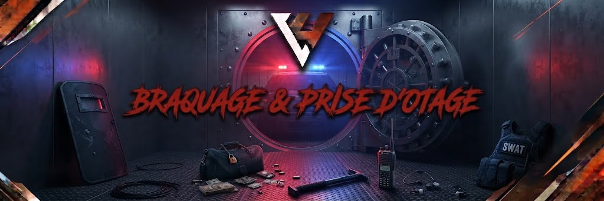

# Braquages & Prises d'Otage 💣

<figure><figcaption></figcaption></figure>

## Braquages & Prises d'Otage — Liberty UnderWorld

Les braquages et enlèvements représentent le sommet de la tension criminelle. Ils doivent impérativement favoriser la négociation, le spectacle et le beau jeu pour l'ensemble des partis en présence (assaillants, otages et forces de l'ordre).

> ⚠️ Mentalité : Un braquage n'est pas une arène d'affrontement armé direct dès l'arrivée de la police. La négociation prime toujours sur l'assaut.

### 1. Cadre Général & Négociations

* Priorité au dialogue : Les assaillants ont l'obligation d'engager la discussion avec le négociateur des forces de l'ordre dès son approche.
* Revendications raisonnables : Les demandes des braqueurs doivent rester cohérentes :
  * _Autorisées :_ Passage libre sans clous au départ, délai de démarrage pour le véhicule de fuite, soins pour un blessé.
  * _Interdites :_ Réclamer des sommes d'argent démesurées en échange de vies, exiger des hélicoptères de combat ou des conditions rendant la poursuite impossible.
* Fin des négociations & Assaut : Les forces de l'ordre ne peuvent lancer l'assaut que si :
  * Un otage est exécuté ou sa vie est mise en péril immédiat.
  * Les braqueurs refusent tout dialogue après plusieurs sommations.
  * Les braqueurs ouvrent le feu les premiers.

### 2. Statut & Règles relatives aux Otages

* Faux otages formellement interdits :
  * Il est interdit de faire appel à des amis, membres de son groupe ou complices pour jouer le rôle d'otage.
  * Les otages doivent être de véritables civils capturés sur une scène RP préalable.
* Personnels protégés : Les membres des services d'urgence en service (EMS, soignants) ne peuvent en aucun cas être pris en otage.
* Traitement de l'otage :
  * L'otage doit coopérer et respecter le Fear RP sous la contrainte d'une arme.
  * Les ravisseurs doivent respecter l'intégrité de l'otage si les forces de l'ordre respectent les termes négociés. L'abattre gratuitement entraîne de lourdes sanctions pour Free RP.

### 3. Grille des Effectifs & Limites par Braquage

Pour garantir l'équité des scènes, chaque type d'attaque impose des quotas stricts de participants et d'otages :

| **Type de Braquage**      | **Effectif Criminel Max** | **Nombre d'Otages Max** | **Présence LSPD/BCSO requise** | **Véhicule de fuite**                              |
| ------------------------- | ------------------------- | ----------------------- | ------------------------------ | -------------------------------------------------- |
| Supérette / Épicerie      | 2 braqueurs               | 1 otage                 | 2 agents minimum               | Véhicule standard (pas de blindé/sportive extrême) |
| Fleeca Bank               | 4 braqueurs               | 2 otages                | 4 agents minimum               | Berline ou SUV standard                            |
| Bijouterie Vangelico      | 5 braqueurs               | 2 otages                | 5 agents minimum               | Véhicules cohérents                                |
| Banque Centrale (Pacific) | 6 à 8 braqueurs           | 3 à 4 otages            | 8 agents minimum               | Préparation validée par le pôle illégal            |

### 4. Conditions de Fuite & Interdictions

* Véhicules de secours : L'usage d'un second véhicule dissimulé (change de voiture) doit avoir fait l'objet d'une préparation logique et ne doit pas être dupliqué à l'infini.
* Pas de fuite instantanée vers une Safezone : Il est strictement interdit de fuir vers un quartier protégé, un hôpital ou un poste de police pour échapper aux poursuites.
* Rejoindre son quartier : Les criminels ne peuvent ramener une poursuite active dans leur quartier officiel que si l'ensemble des unités de police sont informées des risques d'embuscade territoriale.
