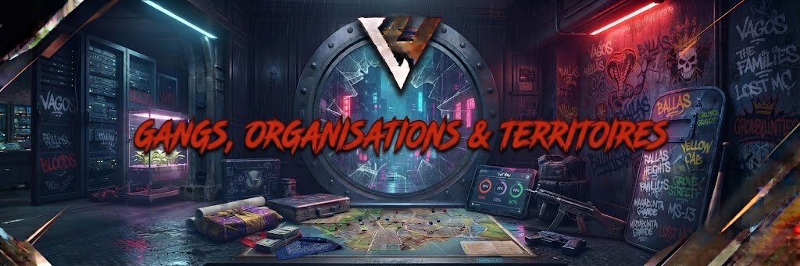

# Gangs, Organisations & Territoires 🏴‍☠️

<figure><figcaption></figcaption></figure>

L'implantation d'un groupe criminel sur le serveur demande de la rigueur, une identité propre et une volonté constante de créer des scènes dynamiques pour la communauté. La puissance d'un groupe se mesure à la qualité de son Roleplay, pas au nombre d'armes stockées dans son coffre.

> 💀 Fair-play criminel : L'objectif d'une organisation n'est pas d'écraser la concurrence pour régner seul sur la ville, mais d'animer des rivalités scénarisées et d'entretenir un climat de tension cohérent.

### 1. Niveaux de Statut & Évolution

L'ascension criminelle se fait par paliers, validés par l'équipe du Pôle Illégal :

| **Statut**          | **Description**                                                   | **Effectif Max** | **Équipements & Droits**                                             |
| ------------------- | ----------------------------------------------------------------- | ---------------- | -------------------------------------------------------------------- |
| Projet / En test    | Groupe émergeant faisant ses preuves dans la rue.                 | 6 membres        | Armes légères de poing, revente de rue, aucun territoire officiel.   |
| Gang / Organisation | Groupe reconnu disposant d'une assise solide et d'un lore validé. | 10 membres       | Quartier revendiqué, accès à des points d'intérêt, trafic structuré. |
| Syndicat / Cartel   | Organisation d'élite influant sur l'ensemble de l'économie noire. | 12 membres       | Importation lourde, blanchiment de capitaux, contrats majeurs.       |

### 2. Territoires & Revendications de Quartier

* Marquage & Identité : Un groupe doit afficher son identité (couleurs, tenue vestimentaire, tatouages, tags) dès lors qu'il opère sur son quartier ou sur une zone contestée.
* Respect du Mass RP : Les quartiers résidentiels ou industriels comportent des civils invisibles. Les fusillades gratuites ou répétées sans raison majeure dans son propre quartier nuisent à la cohérence de l'organisation.
* Intrusion sur territoire rival : Pénétrer dans le quartier d'un groupe ennemi avec ses couleurs ou armé est un acte hostile direct justifiant des sommations expresses ou des tirs de riposte.

### 3. Guerres de Territoires & Règlements de Compte

* Déclaration de guerre formelle :
  * Aucun affrontement de longue durée ne peut être lancé unilatéralement.
  * Un dossier de contentieux doit être soumis au Pôle Illégal détaillant les motifs RP du conflit (dettes impayées, trahison, agression de lieutenants).
* Fixation des conditions : Le staff valide avec les deux camps les règles spécifiques de la guerre :
  * Durée de l'affrontement (ex. : 7 jours).
  * Conditions de victoire (prise d'un point de deal, rançon, reddition du chef adverse).
  * Conséquences finales (départ d'un quartier, dissolution du groupe vaincu, mise en faillite).
* Affrontements armés :
  * Plafond de 8 participants maximum par camp sur une même scène de fusillade.
  * Les alliances temporaires sur le terrain entre deux groupes distincts sont formellement interdites pour contourner ce quota.

### 4. Alliances & Pactes de Non-Agression

* Limitation des coalitions : Les monopoles criminels (« méga-alliances » réunissant 3 ou 4 gangs majeurs) sont prohibés afin de ne pas paralyser le jeu et d'éviter un déséquilibre face aux forces de l'ordre.
* Trahison : Rompre une alliance ou dénoncer un groupe partenaire aux autorités doit faire l'objet d'un développement RP travaillé et assumé, exposant les instigateurs à des contrats de représailles.
