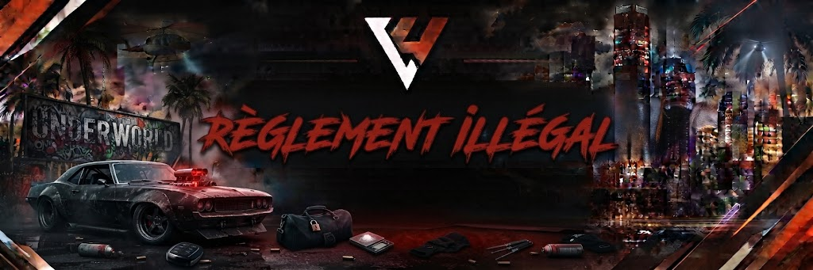

# Règlement Illégal 🥷

<figure><figcaption></figcaption></figure>

## Règlement Illégal

## CATÉGORIE 1 — RÈGLES GÉNÉRALES ILLÉGALES

### 1. Groupes & Organisations

* Hiérarchie & reconnaissance : tout gang, organisation, cartel ou mafia doit être validé par le Pôle Illégal via un dossier complet avant de revendiquer un statut officiel ou un territoire.
* Limites d'effectifs :
* Scène armée ou fusillade : maximum 8 personnes par groupe sur une même scène.
* Aucune alliance temporaire n'est tolérée sur des fusillades actives pour dépasser cette limite.
* Couleurs & signes distinctifs : un groupe officiel doit porter ses couleurs ou signes distinctifs lors des revendications, guerres de territoire ou règlements de compte.

### 2. Tenue

* Portez une tenue cohérente avec votre personnage ou votre groupe.
* Il est strictement interdit de porter un gilet pare-balles factice.
* Il est interdit d'être masqué en ville sans raison. Vous vous exposez à un contrôle de police, et tout abus sera averti.

### 3. Armes

Armes considérées comme légales : Batte de baseball, Club de golf, Clé anglaise, Couteau, Cran d'arrêt, Marteau, Pied de biche, Queue de billard, Poing américain, Couteau Papillon, Karambit, Katana.

→ Si vous n'en faites pas usage, elles ne vous seront pas saisies.

Armes considérées comme illégales : Matraque, Machette, Tesson de bouteille, Hachette, Hache de guerre, Dague antique.

→ Elles peuvent être saisies même sans usage, en cas de délit ou lors d'une palpation.

* Port d'armes : deux armes maximum sur soi, soit une arme lourde/automatique et une arme de poing (ex. : Tec-9 et pistolet de combat).
* Chargeurs : maximum 3 chargeurs par arme (ex. : Beretta 36 munitions = 12x3).

### 4. Braquages & Prises d'Otage

* Préparation & négociations : un braquage doit toujours favoriser la négociation et l'échange avec les forces de l'ordre avant l'affrontement armé.
* Prises d'otage :
* Il est formellement interdit de prendre de « faux otages » (amis, membres du groupe ou complices).
* Les EMS en service ne peuvent pas être pris en otage.
* Les otages doivent être traités de manière cohérente avec le RP. Il est interdit de les abattre sans sommation si la police respecte les termes de la négociation.
* Effectifs par type de braquage :
* Supérette / Épicerie : 2 braqueurs max, 1 otage max.
* Fleeca Bank : 4 braqueurs max, 2 otages max.
* Banque Centrale / Bijouterie : dossier ou autorisation staff requis selon les effectifs LSPD/BCSO connectés.

### 5. Guerres de Groupes & Règlements de Compte

* Sommations : l'usage des armes à feu doit obligatoirement être précédé de sommations orales claires ou d'un contexte de tension lourd et préalable. Le tir à vue sans scène est considéré comme du Free RP.
* Drive-by (tirs en véhicule) :
* Interdit pour le conducteur en toutes circonstances.
* Les passagers ne peuvent tirer que si le véhicule roule à moins de 50 km/h, et avec des armes légères de poing.
* Guerres officielles : déclarées uniquement après accord du Pôle Illégal, qui fixe les conditions de victoire, les limites de temps et les enjeux territoriaux.

### 6. Trafic & Activités Clandestines

* Zones de récolte, traitement et vente : ce sont des zones rouges. Le risque d'interception par des groupes rivaux ou par les forces de l'ordre y est permanent.
* Drogue :
* Les Gangs ne vendent pas leurs propres drogues dans la rue aux PNJ.
* Les Organisations ne peuvent pas vendre dans la rue aux PNJ.
* Interdit de faire des transactions avec des véhicules autres que des camionnettes ou des camions (grosses quantités uniquement).
* Racket & vol de joueurs :
* Pour braquer quelqu'un, il faut de réelles raisons RP. Dépouiller un civil sans raison RP ou à la chaîne est formellement interdit.
* Freeloot : racketter un joueur au hasard juste pour son argent ou ses objets est strictement interdit. Le racket est autorisé uniquement dans le cadre de véritables rivalités entre groupes ou personnes. Le fairplay est encouragé.
* Lors d'un vol, le dépouillement doit rester modéré (armes visibles, argent liquide du moment). Il est interdit de forcer un joueur à retirer de l'argent, à vider ses comptes bancaires ou à céder des véhicules de son garage.
* Limite de loot : vous ne pouvez pas looter plus de 50 % des items lors d'un racket, que ce soit de l'argent ou de la cargaison. Il est recommandé de réclamer moins si les rivalités sont naissantes, ou par fairplay.
* Loot du téléphone : vous pouvez prendre le téléphone d'un joueur, mais vous devez le lui rendre ensuite. Il est interdit de supprimer les contacts, mais vous pouvez supprimer les informations vous concernant si vous avez été pris en photo.

### 7. Mort RP (Wipe de Personnage)

* La mort RP d'un personnage ne peut pas être imposée unilatéralement lors d'un simple braquage ou d'une altercation banale.
* Elle s'applique :
* par demande volontaire du joueur auprès du staff ;
* suite à un dossier « Contrat / Mort RP » validé en amont par le Pôle Illégal avec des motifs RP solides (trahison avérée, infiltration policière découverte, non-respect de pactes majeurs).

## CATÉGORIE 2 — BRAQUAGES & PRISES D'OTAGE

Les braquages et enlèvements représentent le sommet de la tension criminelle. Ils doivent impérativement favoriser la négociation, le spectacle et le beau jeu pour l'ensemble des partis en présence (assaillants, otages et forces de l'ordre).

⚠️ Mentalité : un braquage n'est pas une arène d'affrontement armé dès l'arrivée de la police. La négociation prime toujours sur l'assaut.

### 1. Cadre Général & Négociations

* Priorité au dialogue : les assaillants ont l'obligation d'engager la discussion avec le négociateur des forces de l'ordre dès son approche.
* Revendications raisonnables : les demandes des braqueurs doivent rester cohérentes.
* Autorisées : passage libre sans clous au départ, délai de démarrage pour le véhicule de fuite, soins pour un blessé.
* Interdites : réclamer des sommes d'argent démesurées en échange de vies, exiger des hélicoptères de combat ou des conditions rendant la poursuite impossible.
* Abus des demandes de rançon : il est interdit d'abuser des demandes de rançon.
* Fin des négociations & assaut : les forces de l'ordre ne peuvent lancer l'assaut que si :
* un otage est exécuté ou sa vie est mise en péril immédiat ;
* les braqueurs refusent tout dialogue après plusieurs sommations ;
* les braqueurs ouvrent le feu les premiers.

### 2. Statut & Règles relatives aux Otages

* Faux otages formellement interdits :
* Il est interdit de faire appel à des amis, membres de son groupe ou complices pour jouer le rôle d'otage.
* Les otages doivent être de véritables civils capturés sur une scène RP préalable.
* Personnels protégés : les membres des services d'urgence en service (EMS, soignants) ne peuvent en aucun cas être pris en otage.
* Traitement de l'otage :
* L'otage doit coopérer et respecter le Fear RP sous la contrainte d'une arme.
* Non-respect du « Fear Otage » : il est interdit d'ignorer le risque de mort RP pour le joueur pris en otage.
* Un otage peut subir une mort RP s'il ne montre pas de peur lors de la prise d'otage, ou si son groupe ne se présente pas à la négociation.
* Les ravisseurs doivent respecter l'intégrité de l'otage si les forces de l'ordre respectent les termes négociés. L'abattre gratuitement entraîne de lourdes sanctions pour Free RP.
* Tentative de prise d'otages : il est interdit de tenter de prendre des otages alors que le groupe adverse en a déjà.

### 3. Effectifs & Limites par Braquage

Pour garantir l'équité des scènes, chaque type d'attaque impose des quotas stricts de participants et d'otages :

* Supérette / Épicerie : 2 braqueurs max, 1 otage max, 2 agents LSPD/BCSO minimum. Véhicule de fuite standard (pas de blindé ni de sportive extrême).
* Fleeca Bank : 4 braqueurs max, 2 otages max, 4 agents minimum. Véhicule de fuite : berline ou SUV standard.
* Bijouterie Vangelico : 5 braqueurs max, 2 otages max, 5 agents minimum. Véhicules cohérents.
* Banque Centrale (Pacific) : 6 à 8 braqueurs, 3 à 4 otages, 8 agents minimum. Préparation validée par le Pôle Illégal.

### 4. Conditions de Fuite & Interdictions

* Plans mules : autorisés uniquement avec des véhicules de la catégorie VANS. Ils ne sont pas autorisés pour les petits actes illégaux (vente de drogue, etc.).
* Véhicules de secours : l'usage d'un second véhicule dissimulé (change de voiture) doit avoir fait l'objet d'une préparation logique et ne doit pas être dupliqué à l'infini.
* Pas de fuite instantanée vers une safezone : il est strictement interdit de fuir vers un quartier protégé, un hôpital ou un poste de police pour échapper aux poursuites.
* Rejoindre son quartier : les criminels ne peuvent ramener une poursuite active dans leur quartier officiel que si l'ensemble des unités de police sont informées des risques d'embuscade territoriale.

### 5. Rendez-vous Illégaux

* Organisation : il est interdit d'organiser des rendez-vous illégaux dans des instances.
* Prise d'otages après un rendez-vous : il est interdit de prendre des otages pendant ou après un rendez-vous. Vous devez attendre 5 minutes et être à plus de 2 km du lieu.
* Autorisation de tirer sur rendez-vous : autorisé sous certaines conditions, notamment en cas de manque de respect ou si le groupe ayant les otages décide de tirer. Les otages sont alors soumis à une mort RP.
* Les hauteurs sont interdites durant les rendez-vous.

## CATÉGORIE 3 — GANGS & ORGANISATIONS

### 1. Niveaux de Statut & Évolution

L'ascension criminelle se fait par paliers, validés par l'équipe du Pôle Illégal :

* Projet / En test : groupe émergent faisant ses preuves dans la rue. 6 membres max. Armes légères de poing, revente de rue, aucun territoire officiel.
* Gang / Organisation : groupe reconnu disposant d'une assise solide et d'un lore validé. 10 membres max. Quartier revendiqué, accès à des points d'intérêt, trafic structuré.
* Syndicat / Cartel : organisation d'élite influente sur l'ensemble de l'économie noire. 12 membres max. Importation lourde, blanchiment de capitaux, contrats majeurs.

### 2. Territoires & Revendications de Quartier

* Marquage & identité : un groupe doit afficher son identité (couleurs, tenue vestimentaire, tatouages, tags) dès lors qu'il opère sur son quartier ou sur une zone contestée.
* Respect du Mass RP : les quartiers résidentiels ou industriels comportent des civils invisibles. Les fusillades gratuites ou répétées sans raison majeure dans son propre quartier nuisent à la cohérence de l'organisation.
* Intrusion sur territoire rival : pénétrer dans le quartier d'un groupe ennemi avec ses couleurs ou armé est un acte hostile direct justifiant des sommations expresses ou des tirs de riposte.

### 3. Guerres de Territoires & Règlements de Compte

* Déclaration de guerre formelle :
* Aucun affrontement de longue durée ne peut être lancé unilatéralement.
* Un dossier de contentieux doit être soumis au Pôle Illégal détaillant les motifs RP du conflit (dettes impayées, trahison, agression de lieutenants).
* Fixation des conditions : le staff valide avec les deux camps les règles spécifiques de la guerre :
* durée de l'affrontement (ex. : 7 jours) ;
* conditions de victoire (prise d'un point de deal, rançon, reddition du chef adverse) ;
* conséquences finales (départ d'un quartier, dissolution du groupe vaincu, mise en faillite).
* Affrontements armés :
* Plafond de 8 participants maximum par camp sur une même scène de fusillade.
* Les alliances temporaires sur le terrain entre deux groupes distincts sont formellement interdites pour contourner ce quota.

### 4. Alliances & Pactes de Non-Agression

* Limitation des coalitions : les monopoles criminels (« méga-alliances » réunissant 3 ou 4 gangs majeurs) sont prohibés afin de ne pas paralyser le jeu et d'éviter un déséquilibre face aux forces de l'ordre.
* Trahison : rompre une alliance ou dénoncer un groupe partenaire aux autorités doit faire l'objet d'un développement RP travaillé et assumé, exposant les instigateurs à des contrats de représailles.
