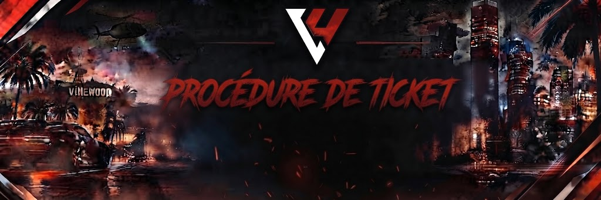

# Procédures de Ticket 🎫

<figure><figcaption></figcaption></figure>

Le système de tickets sur notre serveur Discord constitue l'unique canal officiel pour solliciter l'intervention de l'équipe d'administration et de modération. Afin d'assurer un traitement fluide, équitable et rapide de chaque dossier, merci de prendre connaissance des consignes ci-dessous avant toute ouverture.

> 🚫 Rappel fondamental : Il est strictement interdit d'interpeller un membre de l'équipe en message privé pour traiter d'un problème lié au serveur. Tout passe exclusivement par le salon `#ouvrir-un-ticket`.

### 1. Quand ouvrir un ticket ?

Les tickets sont répartis selon des catégories précises. Sélectionnez l'intitulé correspondant à votre situation :

#### Scène litigieuse & Plainte joueur

* Quand l'utiliser : Vous avez été victime ou témoin d'une infraction caractérisée au règlement (FRP, No Fear, Powergaming, insultes HRP).
* Condition impérative : La scène en jeu doit impérativement être jouée jusqu'à son terme. Il est formellement interdit de couper le dialogue ou de se déconnecter en prétextant l'ouverture d'un ticket.
* Délais : Tout signalement doit intervenir dans les 24 heures suivant l'incident. Au-delà, le dossier sera classé sans suite.

#### Bug technique & Dysfonctionnement

* Quand l'utiliser : Un script ne répond plus, une porte de garage est bloquée, un problème de synchronisation affecte votre session.
* Consigne : Précisez le lieu exact de l'incident, l'heure approximative et la manipulation effectuée au moment de l'erreur.

#### Perte d'inventaire & Demande de remboursement (Refund)

* Quand l'utiliser : Disparition d'objets, d'argent ou de véhicules consécutive à un crash serveur non annoncé, un wipe involontaire ou une mort causée par un bogue avéré.
* Exclusions : Aucune compensation n'est accordée pour :
  * Une mort résultant d'une action de jeu valide (braquage, saisie policière, fusillade régulière).
  * Une négligence du joueur (oubli de fermer son coffre, abandon de véhicule sur la voie publique).

### 2. Critères de Validité des Preuves Vidéo

La majorité des demandes (plaintes et remboursements) exigent des éléments matériels indiscutables. Une simple capture d'écran ou un témoignage écrit ne suffit pas.

#### Outils de capture homologués

* Logiciels acceptés : Medal.tv, OBS Studio, Nvidia Shadowplay, AMD Software.
* Hébergeurs autorisés : Medal, YouTube (vidéo non répertoriée), Streamable. Les fichiers bruts à télécharger (Google Drive, WeTransfer, Mega) sont systématiquement refusés pour des raisons de sécurité.

#### Exigences techniques de l'enregistrement

* Durée minimale du clip : La vidéo doit comporter au moins 1 à 2 minutes continues précédant directement le litige. Les extraits coupés de 10 à 15 secondes masquant le contexte initial de l'altercation sont invalidés d'office.
* Piste audio complète : Le son du jeu ainsi que votre propre voix micro doivent être audibles. Une capture muette ou masquant les paroles du plaignant sera rejetée.
* Qualité d'image : Résolution minimale de 720p à 30 ips afin de permettre la lecture nette de l'interface, de l'horodatage et des identifiants des participants.

### 3. Bonnes Pratiques & Prise en Charge

* Un sujet par ticket : Ne regroupez pas plusieurs affaires distinctes dans une même demande.
* Patience & respect : Les modérateurs traitent les demandes de manière bénévole par ordre chronologique de création. Relancer à répétition par des pings (`@Staff`) ou des messages d'impatience ralentit l'instruction et peut conduire à la clôture du ticket.
* Décision finale : Une fois l'arbitrage rendu par le responsable du ticket après examen des preuves et des logs serveur, la décision est définitive.
