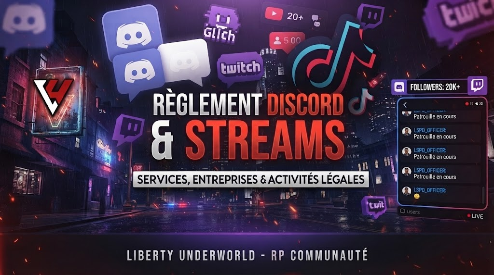

# Règlement Discord & Streams 🎧

<figure><figcaption></figcaption></figure>

La vie communautaire en dehors du jeu reflète l'image du serveur. Tout écart comportemental sur Discord, sur les plateformes de diffusion ou sur les réseaux sociaux fait l'objet des mêmes sanctions qu'une infraction commise directement en jeu.

> 🛡️ Règle générale : Les espaces communautaires sont des zones d'échange bienveillantes. Les différends RP se règlent en RP ; les différends HRP se règlent calmement en privé ou via ticket staff.

### 1. Salons Textuels Discord

* Respect & courtoisie : Insultes, provocations, règlements de compte publics et attitudes toxiques sont formellement prohibés.
* Propos illicites : Tolérance zéro envers tout contenu haineux, raciste, sexiste, homophobe, pornographique (NSFW) ou à caractère diffamatoire. Sanction immédiate : bannissement permanent Discord et FiveM.
* Respect des thématiques : Veillez à poster dans le bon salon (les suggestions dans `#suggestions`, les questions dans `#aide`, etc.). Le spam, le flood et l'abus de mentions de masse (`@everyone`, `@here` ou pings répétés du staff) sont sanctionnés.
* Publicité & démarchage : L'autopromotion pour d'autres projets, l'envoi d'invitations Discord par message privé aux membres sans accord préalable est considéré comme du parasitisme et entraîne une exclusion définitive.

### 2. Salons Vocaux & Attentes

* Salons publics : Les modificateurs de voix abusifs (soundboards criards, modulations extrêmes) et les perturbations sonores volontaires sont interdits.
* Salons d'attente (Besoin d'aide / Tickets) : Restez silencieux et patients dès l'entrée dans un salon d'attente. Aucun démarchage en MP auprès d'un modérateur pour « faire passer plus vite » ne sera toléré.
* Enregistrement sauvage : Enregistrer les conversations vocales d'autrui à leur insu sur Discord à des fins de nuisance ou de chantage est formellement interdit.

### 3. Encadrement des Streameurs & Créateurs de Contenu

Diffuser son jeu sur Twitch, Kick, YouTube ou TikTok participe au rayonnement du serveur, mais impose des devoirs stricts :

* Interdiction formelle du Stream-Stalking / Stream-Snipe :
  * Regarder le live d'un joueur connecté pour obtenir sa position, son inventaire ou ses intentions est assimilé à du Metagaming lourd.
  * Toute interaction en jeu manifestement provoquée par le visionnage d'un flux vidéo direct sera sanctionnée d'un bannissement définitif sans préavis.
* Délai de diffusion (Delay) :
  * Un délai technique (stream delay de 30 à 60 secondes minimum) est vivement recommandé lors de scènes sensibles (opérations de police, guerres de gangs, braquages majeurs).
* Modération du tchat de stream :
  * Le streameur est responsable de sa communauté : interdiction de se servir des alertes ou des indications données par ses spectateurs dans le tchat pour influencer ses décisions en ville (_Backseat RP / Meta_).
  * Il est obligatoire de masquer son écran lors de la composition de codes sensibles (portes d'entrepôt, digicodes, fréquences radio privées).
* Image du serveur & Comportement en direct :
  * Crier au « Free RP », insulter ouvertement un autre joueur devant son audience ou inciter sa communauté au harcèlement à la suite d'une défaite RP est passible de sanctions administratives directes.
